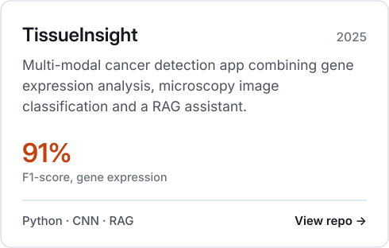
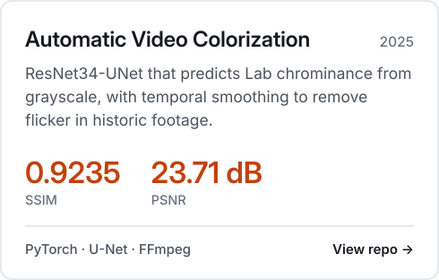
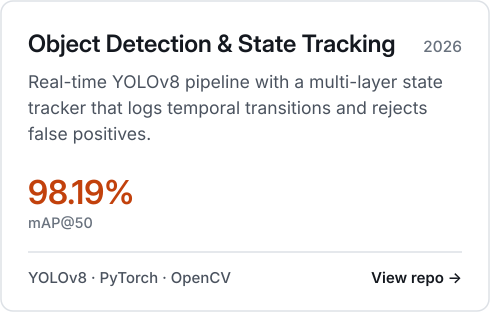
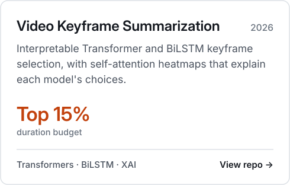
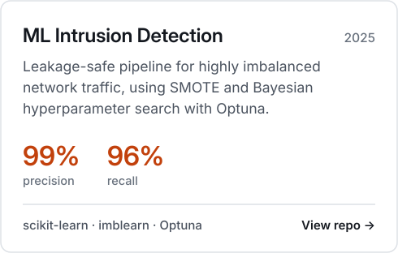
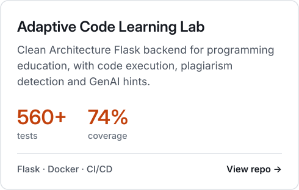
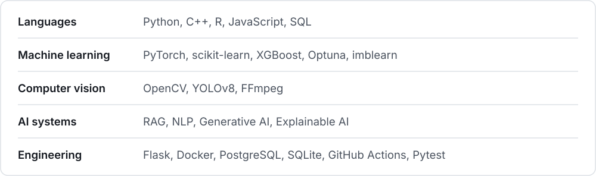
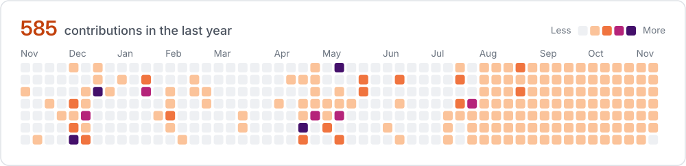

<picture><source media="(prefers-color-scheme: dark)" srcset="./profile/hero-dark.svg"></picture>

  <a href="https://www.linkedin.com/in/omar-hazem-ahmed-229a912wwwaa/"><picture><source media="(prefers-color-scheme: dark)" srcset="./profile/btn-linkedin-dark.svg"></picture></a>
  <a href="https://github.com/OxHazem"><picture><source media="(prefers-color-scheme: dark)" srcset="./profile/btn-github-dark.svg"></picture></a>
  <a href="mailto:omarhazemhassan@gmail.com"><picture><source media="(prefers-color-scheme: dark)" srcset="./profile/btn-email-dark.svg"></picture></a>
  <a href="./resumes/resume_ml.pdf"><picture><source media="(prefers-color-scheme: dark)" srcset="./profile/btn-resume-dark.svg"></picture></a>

## About

I'm a Data Science and AI student at Zewail City (expected 2027), working mostly on computer vision, deep learning and explainable AI. I care about the full path from a clean dataset to a model people can run and understand, and I enjoy the software engineering that makes that possible.

**Open to internships and collaborations.**

- **Researching:** Uncibm, an open-source library that standardizes Concept Bottleneck Models for interpretable deep learning (ongoing, pre-publication)
- **Contributing:** Technical team member at AWS Cloud Club, Zewail City
- **Certified:** Oracle Cloud Infrastructure 2025 Generative AI Professional

## Selected work

  <a href="https://github.com/OxHazem/TissueInsight"><picture><source media="(prefers-color-scheme: dark)" srcset="./profile/project-tissueinsight-dark.svg"></picture></a>
  <a href="https://github.com/OxHazem/video-colorization"><picture><source media="(prefers-color-scheme: dark)" srcset="./profile/project-colorization-dark.svg"></picture></a>

  <a href="https://github.com/OxHazem/Bowling-Tracking-System"><picture><source media="(prefers-color-scheme: dark)" srcset="./profile/project-tracking-dark.svg"></picture></a>
  <a href="https://github.com/OxHazem/video-keyframe-summarization"><picture><source media="(prefers-color-scheme: dark)" srcset="./profile/project-summarization-dark.svg"></picture></a>

  <a href="https://github.com/OxHazem/ml-intrusion-detection-pipeline"><picture><source media="(prefers-color-scheme: dark)" srcset="./profile/project-intrusion-dark.svg"></picture></a>
  <a href="https://github.com/OxHazem/adaptive-code-lab"><picture><source media="(prefers-color-scheme: dark)" srcset="./profile/project-code-lab-dark.svg"></picture></a>

See all projects in my <a href="https://github.com/OxHazem?tab=repositories">repositories</a>.

## Experience

| Role | Organization | Dates |
|:-----|:-------------|:------|
| **Technical Team Member** | AWS Cloud Club, Zewail City | Dec&nbsp;2025&nbsp;–&nbsp;Present |
| **Freelance Data Science and ML Engineer** | Mostaqel | Apr&nbsp;2025&nbsp;–&nbsp;Sep&nbsp;2025 |
| **IBM Data Scientist Intern** | Digital Egypt Pioneers Initiative (DEPI), MCIT | Oct&nbsp;2024&nbsp;–&nbsp;Jun&nbsp;2025 |

## Toolkit

<picture><source media="(prefers-color-scheme: dark)" srcset="./profile/toolkit-dark.svg"></picture>

## Activity

<picture><source media="(prefers-color-scheme: dark)" srcset="./profile/contributions-dark.svg"></picture>

## Resumes

| Track | Focus | Resume |
|:------|:------|:-------|
| **Machine Learning / Data Science** | ML engineering, model training, data pipelines | [Download PDF](./resumes/resume_ml.pdf) |
| **Computer Vision** | CV research, image processing, deep learning | [Request by email](mailto:omarhazemhassan@gmail.com) |
| **Software Engineering** | Backend, systems, general SWE roles | [Request by email](mailto:omarhazemhassan@gmail.com) |
| **General** | One-page overview for broad applications | [Request by email](mailto:omarhazemhassan@gmail.com) |

## Contact

- **LinkedIn:** [omar-hazem-ahmed](https://www.linkedin.com/in/omar-hazem-ahmed-229a912wwwaa/)
- **GitHub:** [OxHazem](https://github.com/OxHazem)
- **Email:** [omarhazemhassan@gmail.com](mailto:omarhazemhassan@gmail.com)
- **Location:** Egypt
